<p align="center">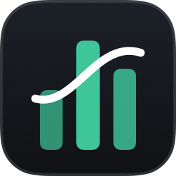</p>

<h1 align="center">MenuStats</h1>

<p align="center">A free, open-source system monitor for the macOS menu bar, made for people who build things.<br>
Resources, apps, ports, AI agents, per-app volume and keep-awake in one panel.</p>

<p align="center">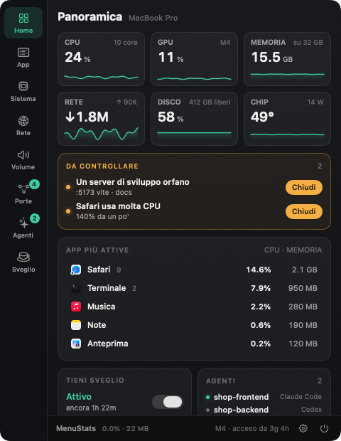</p>

## Features

| | |
|---|---|
| 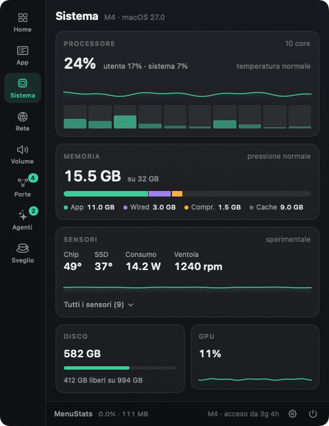 | **System** — CPU per core (user/system), memory breakdown and pressure, swap, GPU, disk, battery, thermal state. Chip/SSD temperatures, fan speed and power draw (experimental). |
| 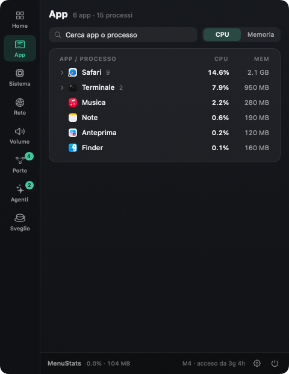 | **Apps** — one row per app: helpers, renderers and XPC services roll up into the app that owns them. Expand to see every process, inspect its code signature (signer, Team ID, hardened runtime, sandbox, Rosetta), quit or force-quit. |
| 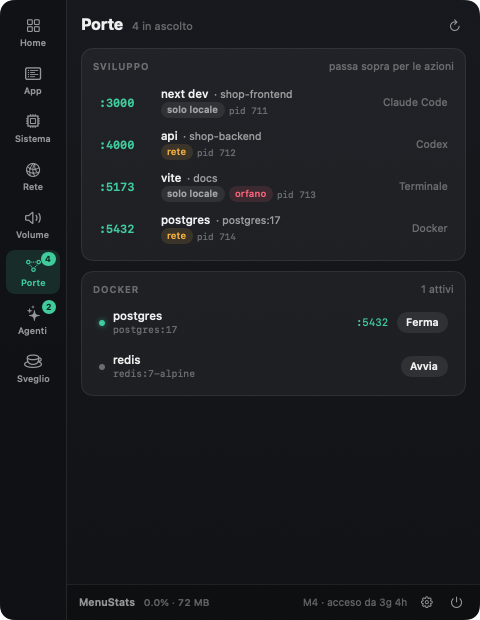 | **Ports** — every listening port with what it serves (`next dev`, `vite`…), the project folder, who started it (Claude Code, Codex, Terminal, Docker), local-only vs network, and **orphaned dev servers**. Docker containers with their port mappings. |
| 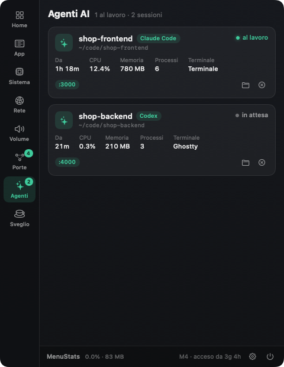 | **AI agents** — running sessions of Claude Code, Codex, Gemini CLI, Aider, OpenCode, Cursor Agent, Amp and Goose: project, terminal, uptime, CPU/memory of the whole process tree, open ports, busy or waiting. |
| 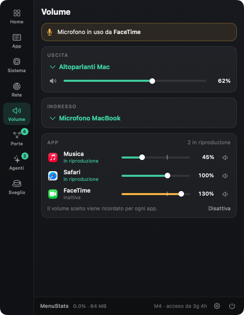 | **Volume** — output/input device pickers, master volume, *"microphone in use by…"*, and an **experimental per-app volume** (0–150 %, remembered per app, no audio driver). |
| 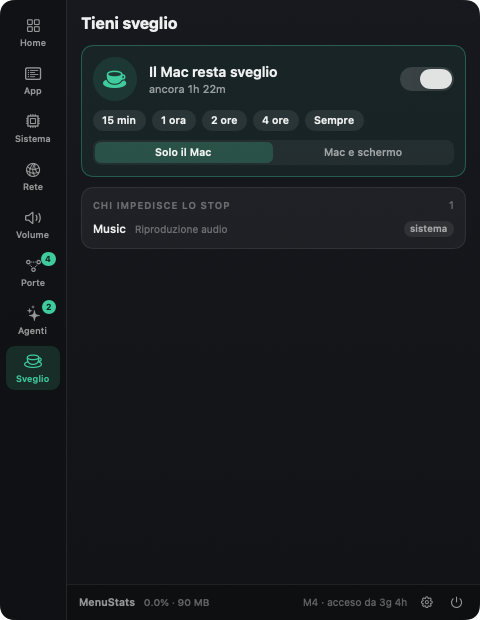 | **Keep awake** — stop the Mac from sleeping for 15 min, 1–4 h or indefinitely (system only, or display too), and see which apps are currently preventing sleep. |
| 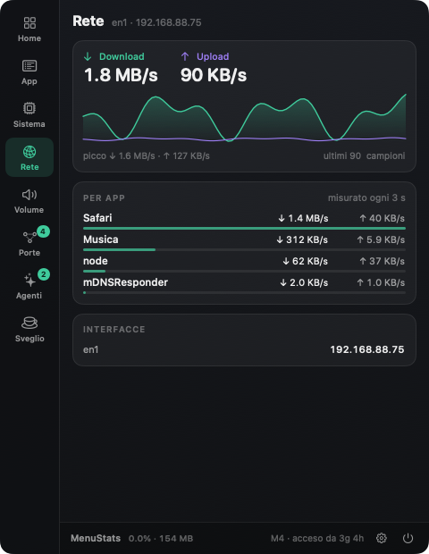 | **Network** — live download/upload with history, traffic per app, interfaces and IP. |

The **Overview** also raises a *"Needs attention"* card for memory pressure, a nearly full disk, thermal throttling, apps hogging the CPU and orphaned dev servers — each with a one-click fix.

### Your menu bar, your way

<p>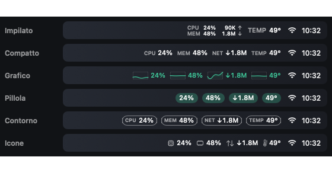</p>

Pick which items to show and in what order (CPU, memory, network, GPU, temperature, power, disk, battery, ports, AI agents), six looks, value colours (menu bar, accent, or green→red by load), system/rounded/monospaced digits and an accent colour.

<p>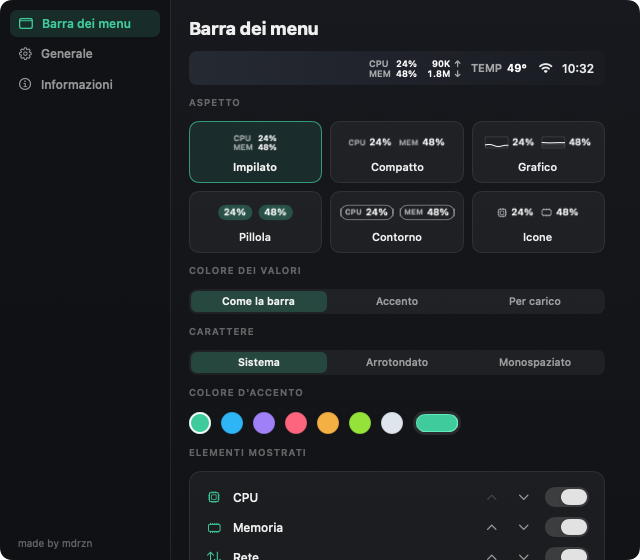</p>

Global shortcut **⌥⌘M** opens the panel (no Accessibility permission needed). Right-click the menu bar item for a quick menu.

## Install

### Option 1 — Download the app

1. Download `MenuStats.zip` from the [latest release](https://github.com/mdrzn/menustats/releases/latest) and unzip it.
2. Move `MenuStats.app` to your **Applications** folder and open it. The icon appears in the menu bar.

Apple Silicon and Intel, macOS 14.2 or later.

#### "MenuStats cannot be opened" — allowing it anyway

MenuStats is free and open source, but not notarized by Apple (that requires a paid developer account), so **Gatekeeper** blocks it the first time. The app is not broken or harmful — you can read and build the source yourself (Option 2).

1. Double-click `MenuStats.app`. When the warning appears, click **Done** (not "Move to Trash").
2. Open **System Settings → Privacy & Security**.
3. In the **Security** section you'll see *"MenuStats was blocked to protect your Mac"*. Click **Open Anyway**.
4. Confirm with your password or Touch ID, then click **Open**.

Only needed once. Or, from Terminal: `xattr -dr com.apple.quarantine /Applications/MenuStats.app`

### Option 2 — Build it yourself

Needs macOS 14.2+ and the Xcode Command Line Tools (`xcode-select --install`), no Xcode project. A locally built app isn't blocked by Gatekeeper.

```sh
git clone https://github.com/mdrzn/menustats.git
cd menustats
./build.sh              # builds MenuStats.app for this Mac
open MenuStats.app
```

`./build.sh --universal` builds an Apple Silicon + Intel app and `MenuStats.zip`. `./make-screenshots.sh` regenerates the images above with demo data.

## Experimental features — please read

- **Sensors (temperatures, fans, power)** use private macOS interfaces (IOHIDEventSystem and the SMC), like other open-source monitors do. They are read-only, but a macOS update may break them; MenuStats then simply hides the values.
- **Per-app volume** is **off by default**. macOS has no per-app volume, so MenuStats uses Core Audio *process taps* (macOS 14.2+): the app's sound is captured, muted at the source and played back at the volume you choose. This requires the **System Audio Recording** permission. Audio is never recorded or saved, and it adds a small extra latency — fine for music and video, possibly noticeable in calls. Quitting MenuStats gives the sound back to the apps.

## Privacy

Everything is computed locally. MenuStats makes no network requests, has no analytics and no account. Port and process information comes from `lsof`, `nettop` and `libproc`; Docker data from your own `docker` CLI if installed.

## Notes

- The interface is currently in Italian.
- Inspired by the idea behind [Stat Space](https://statspace.app/), a commercial menu bar monitor. MenuStats is an independent, from-scratch open-source project and shares no code or assets with it.

## Credits

Made by [mdrzn](https://github.com/mdrzn). MIT License.
