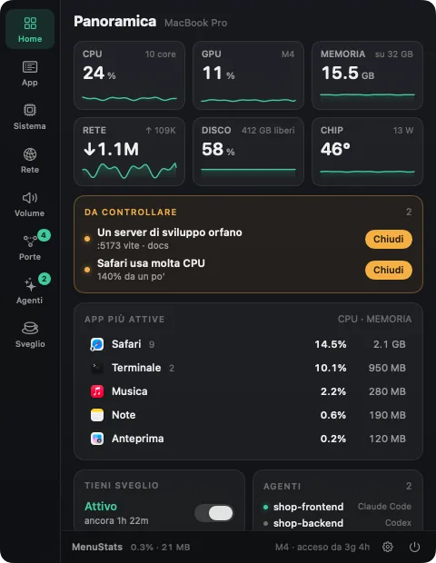
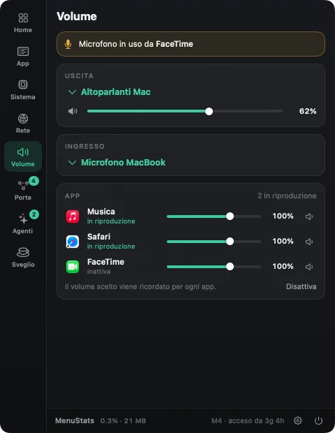
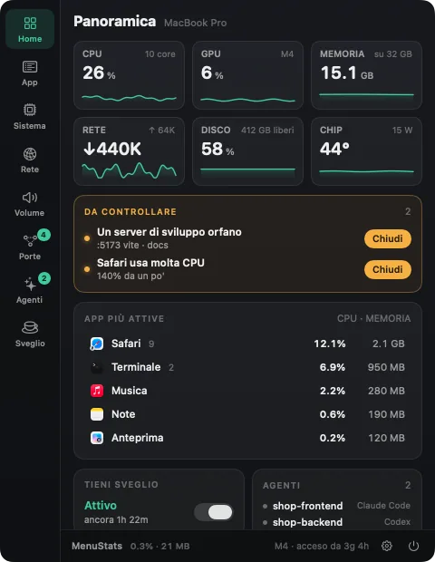
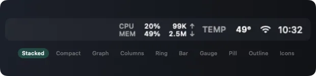
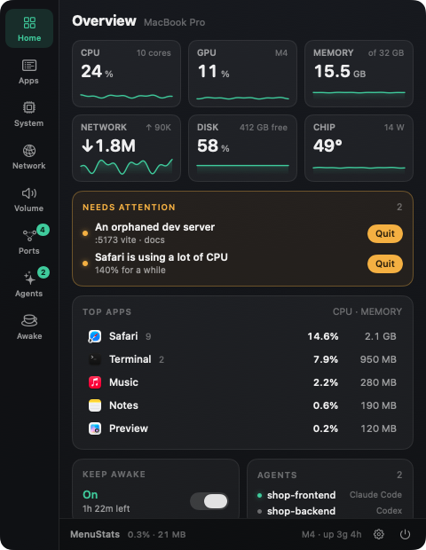
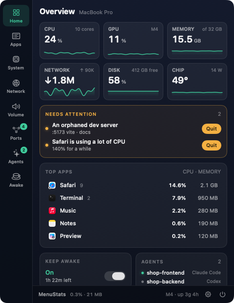
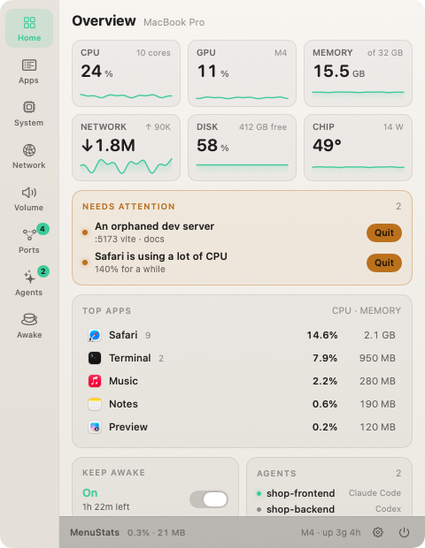
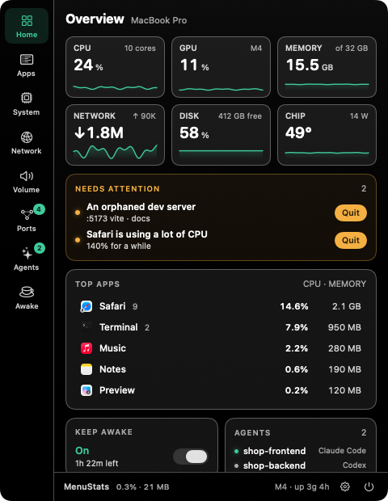

<p align="center"></p>

<h1 align="center">MenuStats</h1>

<p align="center">A free, open-source system monitor for the macOS menu bar, made for people who build things.<br>
Resources, apps, ports, AI agents, per-app volume and keep-awake in one panel.</p>

<p align="center"></p>

## Features

| | |
|---|---|
|  | **System** — CPU per core (user/system), memory breakdown and pressure, swap, GPU, disk, battery, thermal state, with **live, 1-hour and 24-hour history** (saved across restarts). Chip/SSD temperatures, fan speed and power draw (experimental). Battery of Bluetooth peripherals (Apple mice/keyboards, AirPods). |
|  | **Apps** — one row per app: helpers, renderers and XPC services roll up into the app that owns them. Expand to see every process, inspect its code signature (signer, Team ID, hardened runtime, sandbox, Rosetta), and **restart**, quit or force-quit an app — or let MenuStats **restart it automatically** when it goes over a memory limit. |
|  | **Ports** — every listening port with what it serves (`next dev`, `vite`…), the project folder, who started it (Claude Code, Codex, Terminal, Docker), local-only vs network, and **orphaned dev servers**. Open or copy the URL, stop the process. Docker containers with their port mappings. |
|  | **AI agents** — running sessions of Claude Code, Codex, Gemini CLI, Aider, OpenCode, Cursor Agent, Amp and Goose: project, terminal, uptime, CPU/memory of the whole process tree, open ports, busy or waiting. For Claude Code also the **model, token usage and last message**, read from its local logs. |
|  | **Network** — live download/upload, 1 h / 24 h history, **data used today and this month**, traffic per app, Wi-Fi signal and link speed, active VPN (e.g. Tailscale), and a **speed test** using Apple's built-in `networkQuality`. |
|  | **Volume** — output/input device pickers, master volume, *"microphone in use by…"*, and an **experimental per-app volume** (0–150 %, remembered per app, no audio driver). |
|  | **Keep awake** — stop the Mac from sleeping for 15 min, 1–4 h or indefinitely, or **automatically** while an AI agent is working, a dev server is running or the Mac is on power. See which apps are preventing sleep. |

<p align="center"></p>

The **Overview** raises a *"Needs attention"* card for memory pressure, a nearly full disk, thermal throttling, apps hogging the CPU and orphaned dev servers — each with a one-click fix.

### Notifications

Get a notification when **an AI agent finishes or is waiting for you**, a **dev server stops** on its own, an app is **restarted automatically**, the disk is almost full, memory is under pressure or the Mac is very hot. Each type can be turned off; clicking a notification opens the right tab.

### Your menu bar, your way

<p></p>

- **Items:** CPU, memory, network, GPU, temperature, power, disk used or free, battery, ports, AI agents, time and date, public IP, ping, uptime, plus *keep-awake* and *microphone* indicators that only appear when active.
- **One item or many:** show everything in one item, or one item per entry — clicking each opens the panel on the matching tab (⌘-drag to reorder).
- **Ten looks:** stacked, compact, graph, columns, ring, bar, gauge, pill, outline, icons.
- **Colours and labels:** values in the menu bar colour, your accent, or green → red by load with your own thresholds; custom or hidden labels; system, rounded or monospaced digits.
- **Minimal mode:** just an icon that turns yellow or red when something needs attention.

### Themes

| Graphite | Midnight | Paper | High contrast |
|---|---|---|---|
|  |  |  |  |

*Automatic* follows the macOS light/dark appearance. Also: seven accent colours or any colour you like, colours by area (CPU, memory, network…), compact/normal/large text, opaque or translucent panel.

<p></p>

**English and Italian** (follows the system language, or pick one). Shortcuts: **⌥⌘M** opens the panel, **⌥⌘1…8** jump to a tab — no Accessibility permission needed. Settings can be exported to a file and imported on another Mac. Right-click the menu bar item for a quick menu.

## Install

### Option 1 — Homebrew

```sh
brew install --cask --no-quarantine mdrzn/tap/menustats
```

`--no-quarantine` skips the first-launch Gatekeeper block described below (MenuStats isn't notarized). Without it, Homebrew installs the app normally and you allow it once as in Option 2.

### Option 2 — Download the app

1. Download `MenuStats.zip` from the [latest release](https://github.com/mdrzn/menustats/releases/latest) and unzip it.
2. Move `MenuStats.app` to your **Applications** folder and open it. The icon appears in the menu bar.

Apple Silicon and Intel, macOS 14.2 or later.

#### "MenuStats cannot be opened" — allowing it anyway

MenuStats is free and open source, but not notarized by Apple (that requires a paid developer account), so **Gatekeeper** blocks it the first time. The app is not broken or harmful — you can read and build the source yourself (Option 3).

1. Double-click `MenuStats.app`. When the warning appears, click **Done** (not "Move to Trash").
2. Open **System Settings → Privacy & Security**.
3. In the **Security** section you'll see *"MenuStats was blocked to protect your Mac"*. Click **Open Anyway**.
4. Confirm with your password or Touch ID, then click **Open**.

Only needed once. Or, from Terminal: `xattr -dr com.apple.quarantine /Applications/MenuStats.app`

### Option 3 — Build it yourself

Needs macOS 14.2+ and the Xcode Command Line Tools (`xcode-select --install`), no Xcode project. A locally built app isn't blocked by Gatekeeper.

```sh
git clone https://github.com/mdrzn/menustats.git
cd menustats
./build.sh              # builds MenuStats.app for this Mac
open MenuStats.app
```

- `./build.sh --universal` builds an Apple Silicon + Intel app and `MenuStats.zip`.
- `./make-screenshots.sh` and `./make-demos.sh` regenerate the images and animations above with demo data (`make-demos.sh` needs `img2webp`: `brew install webp`).
- `./make-icon.sh` regenerates the app icon.

MenuStats checks GitHub once a day for a newer release and shows a banner in the panel footer (can be turned off).

## Experimental features — please read

- **Sensors (temperatures, fans, power)** use private macOS interfaces (IOHIDEventSystem and the SMC), like other open-source monitors do. They are read-only, but a macOS update may break them; MenuStats then simply hides the values.
- **Per-app volume** is **off by default**. macOS has no per-app volume, so MenuStats uses Core Audio *process taps* (macOS 14.2+): the app's sound is captured, muted at the source and played back at the volume you choose. This requires the **System Audio Recording** permission. Audio is never recorded or saved. Quitting MenuStats gives the sound back to the apps.
- **Wi-Fi network name:** macOS only reveals it to apps with Location permission, so MenuStats shows signal and speed but usually not the name.

## Privacy

Everything is computed locally: no analytics, no account. Port and process information comes from `lsof`, `nettop` and `libproc`; Docker data from your own `docker` CLI if installed; Claude Code details from its logs in `~/.claude/projects`, read-only.

MenuStats only contacts the Internet for things you can see and switch off:

| What | Where | When |
|---|---|---|
| Update check | `api.github.com` | once a day; *Settings → General* |
| Public IP | `api.ipify.org` | only if you add the *Public IP* item |
| Ping | the host you choose (default `1.1.1.1`) | only if you add the *Ping* item |
| Speed test | Apple's servers via `networkQuality` | only when you click *Run test* |

## Notes

- Inspired by the idea behind [Stat Space](https://statspace.app/), a commercial menu bar monitor. MenuStats is an independent, from-scratch open-source project and shares no code or assets with it.

## Credits

Made by [mdrzn](https://github.com/mdrzn). MIT License.
